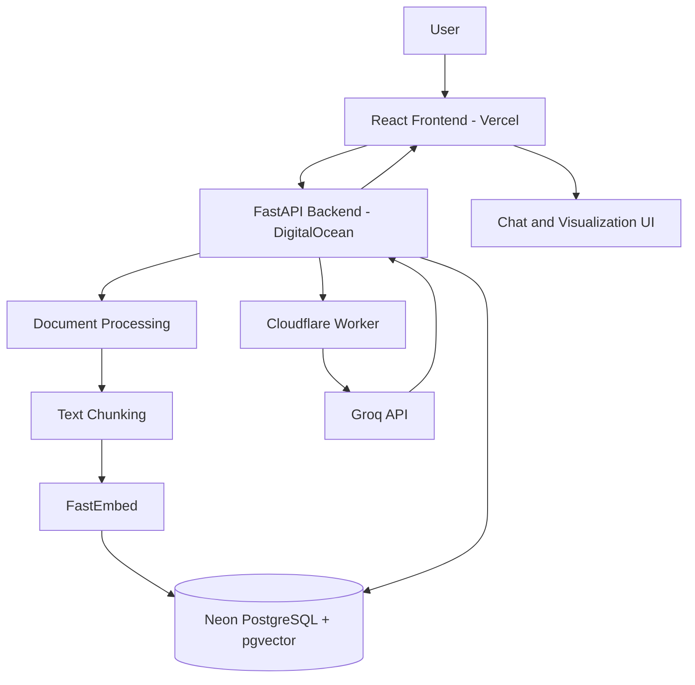
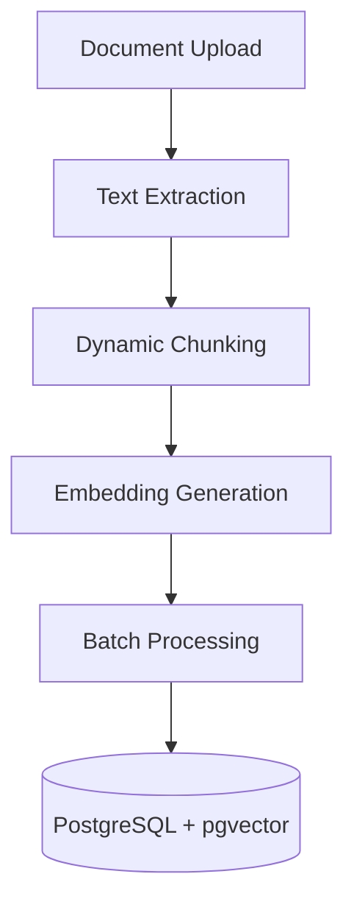
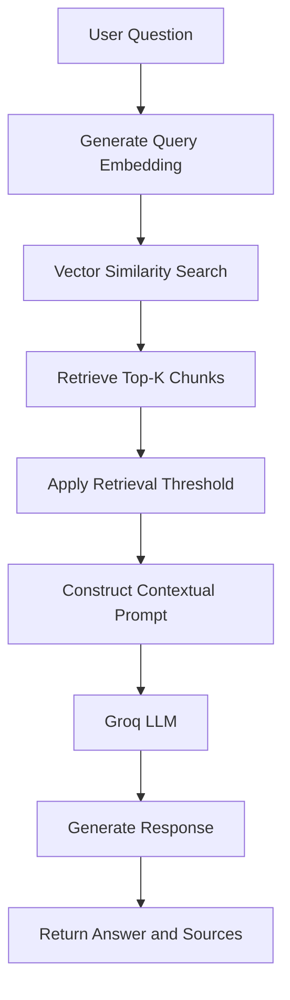

# 🧠 NeuralDocs – Full-Stack RAG Knowledge Intelligence Platform

**NeuralDocs** is a production-ready, session-isolated Retrieval-Augmented Generation (RAG) platform that transforms documents into an intelligent, searchable knowledge base. Users can upload documents, ask context-aware questions, explore semantic embeddings, and receive AI-generated answers with source citations and confidence information.

Built using **FastAPI, LangChain, PostgreSQL + pgvector, React (Vite), FastEmbed, and Groq**, NeuralDocs combines modern AI technologies with a scalable full-stack architecture.


## ✨ Key Features

- 📄 **Multi-Format Document Upload** – Upload and process PDF, TXT, CSV, and Markdown files.
- 🧠 **Intelligent Document Chunking** – Dynamically adjusts chunk sizes based on document length and uses batch embedding generation to minimize memory consumption.
- 🔍 **Semantic Vector Search** – Uses PostgreSQL and pgvector to retrieve relevant document chunks through vector similarity search.
- 🔒 **Session-Isolated Retrieval** – Maintains document isolation across user sessions to prevent cross-session data retrieval.
- 💬 **Context-Aware AI Chatbot** – Ask questions about uploaded documents and receive AI-generated answers grounded in retrieved context.
- 📚 **Source Citations** – Provides references to the document content used to generate responses.
- 🎯 **Confidence Information** – Displays retrieval-related confidence information alongside generated answers.
- 📊 **Embedding Visualization** – Uses t-SNE to project high-dimensional document embeddings into an interactive 2D visualization.
- 📈 **Usage & Performance Monitoring** – Tracks token consumption, request latency, and API activity.
- 🧹 **Automated Session Management** – Implements session heartbeats and automatic cleanup of inactive sessions after one hour.
- 🚀 **Dockerized Deployment** – Containerized backend deployment with a separately deployed React frontend.
- 🔐 **Secure API Integration** – Uses Cloudflare Workers as a proxy for Groq API requests, keeping API credentials outside the frontend.

---

## 🛠️ Technology Stack

| Layer | Technologies |
|---|---|
| Frontend | React 18, Vite, Axios, Plotly.js, React Dropzone |
| Backend | Python, FastAPI, LangChain, Uvicorn |
| Vector Database | PostgreSQL, pgvector, Neon |
| Embedding Model | FastEmbed, BAAI/bge-small-en-v1.5 |
| LLM Inference | Groq API, openai/gpt-oss-120b |
| API Proxy | Cloudflare Workers |
| Containerization | Docker |
| Frontend Deployment | Vercel |
| Backend Deployment | DigitalOcean Droplet |
| Database Hosting | Neon PostgreSQL |
| Monitoring | Docker Logs, Docker Stats, DigitalOcean Metrics |

---

## 🏗️ System Architecture

NeuralDocs follows a modular full-stack architecture that connects the React frontend, FastAPI backend, vector database, embedding model, and LLM inference service.

### High-Level Architecture



### Document Ingestion Pipeline



### Retrieval-Augmented Generation Pipeline



### Component Responsibilities

- **React Frontend:** Handles document uploads, conversations, visualizations, and user interactions.
- **FastAPI Backend:** Manages API requests, document processing, retrieval, and response generation.
- **FastEmbed:** Converts document chunks and user queries into numerical embeddings.
- **PostgreSQL + pgvector:** Stores document embeddings and performs vector similarity searches.
- **LangChain:** Orchestrates document retrieval and LLM interactions.
- **Cloudflare Workers:** Acts as a secure proxy between the backend and Groq API.
- **Groq:** Provides LLM inference for context-aware answer generation.

---

## ⚡ Performance Optimizations

NeuralDocs incorporates several optimizations to improve processing efficiency and reduce resource consumption.

| Optimization | Implementation |
|---|---|
| Dynamic Chunk Sizing | Uses 500, 1000, or 1500 characters based on document length |
| Batch Embedding | Processes embeddings in batches of 100 chunks |
| Memory Management | Uses `gc.collect()` after embedding batches |
| Lightweight Embeddings | Uses BAAI/bge-small-en-v1.5 (approximately 67 MB) |
| CPU-Friendly Processing | Uses FastEmbed without requiring PyTorch |
| Configurable Retrieval | Supports configurable Top-K and similarity thresholds |
| API Proxy | Routes Groq requests through Cloudflare Workers |

---

## 🔐 Environment Configuration

Create a `.env` file in the backend directory and configure the required environment variables.

| Variable | Description |
|---|---|
| `DATABASE_URL` | Neon PostgreSQL connection string |
| `GROQ_API_KEY` | Groq API key, if using direct API access |
| `PROXY_BASE_URL` | Cloudflare Worker proxy base URL |
| `PROXY_ACCESS_TOKEN` | Optional authentication token for the proxy |
| `RETRIEVAL_THRESHOLD` | Minimum similarity threshold for retrieval |
| `TOP_K` | Number of relevant document chunks retrieved per query |

**Security Notes:**
- Never commit `.env` files or API credentials to GitHub.
- Configure production secrets through the relevant hosting platform.
- Keep API credentials on the backend or within the Cloudflare Worker.
- Use HTTPS for application communication.

---

## 🚀 Deployment Architecture

NeuralDocs uses separate deployment environments for its frontend, backend, database, and LLM API proxy.

| Component | Hosting Platform |
|---|---|
| Frontend | Vercel |
| Backend | DigitalOcean Droplet |
| Database | Neon PostgreSQL |
| LLM API Proxy | Cloudflare Workers |
| Containerization | Docker |

The React frontend communicates with the FastAPI backend through HTTPS API requests.

The backend handles document processing and retrieval, while Groq requests are routed through the Cloudflare Worker proxy.

---

## 💻 Local Development

### Prerequisites

- Python 3.10+
- Node.js and npm
- PostgreSQL with pgvector support or a Neon PostgreSQL database
- Groq API credentials or configured Cloudflare Worker proxy
- Git

### 1. Clone the repository

```bash
git clone https://github.com/YOUR_USERNAME/NeuralDocs.git
cd NeuralDocs
```

### 2. Set up the backend

```bash
cd backend

python -m venv venv
```

Activate the environment:

**Windows:**

```bash
venv\Scripts\activate
```

**Linux/macOS:**

```bash
source venv/bin/activate
```

Install dependencies:

```bash
pip install -r requirements.txt
```

Configure the backend `.env` file with the required environment variables.

Start the FastAPI server:

```bash
uvicorn main:app --reload
```

### 3. Set up the frontend

Open another terminal:

```bash
cd frontend

npm install
npm run dev
```

Open the local frontend URL provided by Vite in your browser.

**Note:** The commands above assume the repository uses the indicated directory names, entry point, and requirements file. Adjust them if your source structure differs.

---

## 📂 Core RAG Concepts Implemented

NeuralDocs demonstrates several important concepts in modern Generative AI application development:

1. **Document Ingestion:** Extracting text from different file formats.
2. **Text Chunking:** Dividing large documents into smaller, retrievable sections.
3. **Embedding Generation:** Representing text as numerical vectors.
4. **Vector Similarity Search:** Finding semantically relevant document chunks.
5. **Retrieval-Augmented Generation:** Supplying retrieved context to an LLM before generating an answer.
6. **Contextual Prompting:** Guiding the LLM to answer using relevant document information.
7. **Source Attribution:** Connecting generated answers with their supporting document chunks.
8. **Embedding Visualization:** Exploring document representations in a two-dimensional space.
9. **Session Isolation:** Separating document retrieval across independent sessions.
10. **Performance Monitoring:** Observing token consumption and response latency.

---

## 🔮 Future Enhancements

Potential improvements for future versions include:

- Hybrid Search combining BM25 and vector similarity.
- Cross-encoder reranking for improved retrieval relevance.
- RAG evaluation using RAGAS.
- Conversation memory and contextual follow-up questions.
- Streaming AI responses.
- Authentication and persistent user accounts.
- Advanced document parsing and OCR.
- Agentic RAG with LangGraph.
- Improved retrieval observability and hallucination analysis.

---

## 🤝 Contributing

NeuralDocs is a personal portfolio project, and suggestions, feedback, and contributions are welcome.

If you find an issue or have an idea for improvement, feel free to open an issue or submit a pull request.

---

## 🙏 Acknowledgements

Built with the support of these open-source technologies and services:

- [LangChain](https://www.langchain.com/)
- [FastAPI](https://fastapi.tiangolo.com/)
- [FastEmbed](https://github.com/qdrant/fastembed)
- [PostgreSQL](https://www.postgresql.org/)
- [pgvector](https://github.com/pgvector/pgvector)
- [Groq](https://groq.com/)
- [Cloudflare Workers](https://workers.cloudflare.com/)
- [React](https://react.dev/)
- [Vercel](https://vercel.com/)
- [DigitalOcean](https://www.digitalocean.com/)
- [Neon](https://neon.com/)

---

<p align="center">
  <strong>NeuralDocs – Turning Documents into Intelligence.</strong>
  <br>
  Built with ❤️ using Generative AI and modern full-stack technologies.
</p>